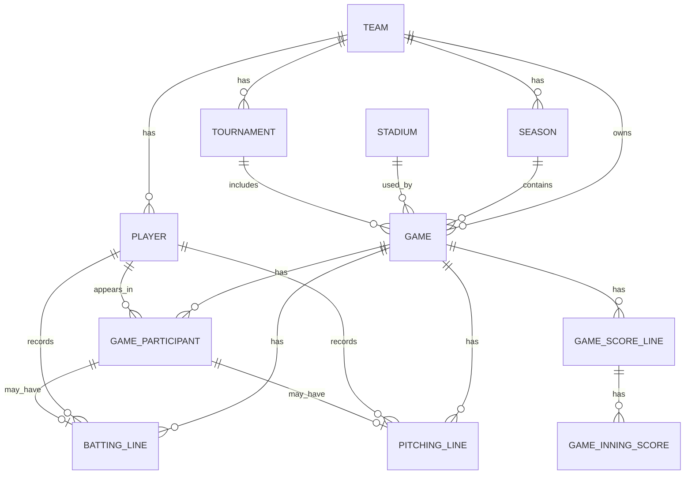

# データベース設計

対象: 新琴似CATS 非公式公開サイト MVP のDB設計

この文書はDBの物理設計とDBレベルの制約を正とする。ドメイン上の意味は
[ドメインモデル](domain-model.md)、公開契約は [API設計](api-design.md) を参照する。

## 1. DB設計の基本方針

- MVP は新琴似CATS 1チーム運用
- 将来の複数チーム対応を見据えて `teams` を中心にする
- 過去試合の表示を壊さないため、スナップショットと履歴保持を重視する
- 管理画面・認証・権限系テーブルは MVP では持たない
- PostgreSQL を前提にする
- 主キーは `bigint generated by default as identity`
- カラム名は snake_case
- 外部キー列は `xxx_id`

現行のFlywayは、初期スキーマと公開確認用seedをまとめた
`V1__create_initial_schema.sql` と、V1適用済み環境の接続後に `public` schemaを使うための
`V2__restore_public_search_path.sql` で構成する。V2は新しい業務テーブルを追加する
migrationではない。

## 2. テーブル一覧

### 現行migrationに存在するテーブル

- `teams`
- `seasons`
- `players`
- `tournaments`
- `stadiums`
- `games`
- `game_participants`
- `batting_lines`
- `pitching_lines`
- `game_score_lines`
- `game_inning_scores`

### C. 将来追加候補

- 認証・権限: `users`, `team_memberships`, `roles`
- 集計: `player_summaries`, `team_summaries`, `ranking_snapshots`
- 詳細記録: `game_events`, `plate_appearances`, `fielding_lines`
- コンテンツ: `awards`, `photos`, `photo_albums`

## 3. 現行テーブル定義

### 3-1. `teams`

| カラム名         | 型のイメージ   | NULL可否 | 説明             | 備考                                 |
| ---------------- | -------------- | -------: | ---------------- | ------------------------------------ |
| `id`             | `bigint`       |     不可 | チームID         | PK, GENERATED BY DEFAULT AS IDENTITY |
| `slug`           | `varchar(100)` |     不可 | URL 用識別子     | 一意制約                             |
| `name`           | `varchar(255)` |     不可 | チーム正式名称   |                                      |
| `short_name`     | `varchar(100)` |       可 | 短い表示名       |                                      |
| `area`           | `varchar(255)` |       可 | 活動エリア       |                                      |
| `founded_year`   | `int`          |       可 | 結成年           |                                      |
| `description`    | `text`         |       可 | チーム紹介文     |                                      |
| `logo_url`       | `varchar(500)` |       可 | ロゴ画像URL      |                                      |
| `main_image_url` | `varchar(500)` |       可 | メイン画像URL    |                                      |
| `is_active`      | `boolean`      |     不可 | 公開対象かどうか |                                      |
| `created_at`     | `timestamp`    |     不可 | 作成日時         |                                      |
| `updated_at`     | `timestamp`    |     不可 | 更新日時         |                                      |
| `deleted_at`     | `timestamp`    |       可 | 論理削除日時     |                                      |

### 3-2. `seasons`

| カラム名     | 型のイメージ   | NULL可否 | 説明                 | 備考            |
| ------------ | -------------- | -------: | -------------------- | --------------- |
| `id`         | `bigint`       |     不可 | シーズンID           | PK              |
| `team_id`    | `bigint`       |     不可 | 所属チームID         | `teams.id` 参照 |
| `year`       | `int`          |     不可 | 年度                 |                 |
| `name`       | `varchar(255)` |     不可 | 表示名               |                 |
| `start_date` | `date`         |       可 | 開始日               |                 |
| `end_date`   | `date`         |       可 | 終了日               |                 |
| `is_current` | `boolean`      |     不可 | 現在シーズンかどうか |                 |
| `created_at` | `timestamp`    |     不可 | 作成日時             |                 |
| `updated_at` | `timestamp`    |     不可 | 更新日時             |                 |

### 3-3. `players`

| カラム名            | 型のイメージ   | NULL可否 | 説明         | 備考            |
| ------------------- | -------------- | -------: | ------------ | --------------- |
| `id`                | `bigint`       |     不可 | 選手ID       | PK              |
| `team_id`           | `bigint`       |     不可 | 所属チームID | `teams.id` 参照 |
| `name`              | `varchar(255)` |     不可 | 選手名       |                 |
| `kana`              | `varchar(255)` |       可 | ふりがな     |                 |
| `uniform_number`    | `varchar(10)`  |       可 | 背番号       |                 |
| `primary_position`  | `varchar(50)`  |       可 | 主な守備位置 |                 |
| `throwing_hand`     | `varchar(20)`  |       可 | 投           |                 |
| `batting_hand`      | `varchar(20)`  |       可 | 打           |                 |
| `joined_at`         | `date`         |       可 | 加入日       |                 |
| `left_at`           | `date`         |       可 | 退団日       |                 |
| `profile_image_url` | `varchar(500)` |       可 | 画像URL      |                 |
| `description`       | `text`         |       可 | 紹介文       |                 |
| `created_at`        | `timestamp`    |     不可 | 作成日時     |                 |
| `updated_at`        | `timestamp`    |     不可 | 更新日時     |                 |

### 3-4. `tournaments`

| カラム名        | 型のイメージ   | NULL可否 | 説明         | 備考            |
| --------------- | -------------- | -------: | ------------ | --------------- |
| `id`            | `bigint`       |     不可 | 大会ID       | PK              |
| `team_id`       | `bigint`       |     不可 | 所属チームID | `teams.id` 参照 |
| `name`          | `varchar(255)` |     不可 | 大会名       |                 |
| `short_name`    | `varchar(100)` |       可 | 短い表示名   |                 |
| `season_year`   | `int`          |       可 | 対象年度     |                 |
| `description`   | `text`         |       可 | 説明         |                 |
| `display_order` | `int`          |     不可 | 表示順       |                 |
| `created_at`    | `timestamp`    |     不可 | 作成日時     |                 |
| `updated_at`    | `timestamp`    |     不可 | 更新日時     |                 |

### 3-5. `stadiums`

| カラム名      | 型のイメージ   | NULL可否 | 説明     | 備考 |
| ------------- | -------------- | -------: | -------- | ---- |
| `id`          | `bigint`       |     不可 | 球場ID   | PK   |
| `name`        | `varchar(255)` |     不可 | 球場名   |      |
| `address`     | `varchar(255)` |       可 | 住所     |      |
| `city`        | `varchar(255)` |       可 | 市区町村 |      |
| `prefecture`  | `varchar(255)` |       可 | 都道府県 |      |
| `description` | `text`         |       可 | 備考     |      |
| `created_at`  | `timestamp`    |     不可 | 作成日時 |      |
| `updated_at`  | `timestamp`    |     不可 | 更新日時 |      |

### 3-6. `games`

| カラム名        | 型のイメージ   | NULL可否 | 説明                | 備考                  |
| --------------- | -------------- | -------: | ------------------- | --------------------- |
| `id`            | `bigint`       |     不可 | 試合ID              | PK                    |
| `team_id`       | `bigint`       |     不可 | 所属チームID        | `teams.id` 参照       |
| `season_id`     | `bigint`       |     不可 | 対象シーズンID      | `seasons.id` 参照     |
| `tournament_id` | `bigint`       |       可 | 大会ID              | `tournaments.id` 参照 |
| `stadium_id`    | `bigint`       |       可 | 球場ID              | `stadiums.id` 参照    |
| `game_date`     | `date`         |     不可 | 試合日              |                       |
| `start_time`    | `time`         |       可 | 開始時刻            |                       |
| `opponent_name` | `varchar(255)` |     不可 | 対戦相手名          |                       |
| `home_away`     | `varchar(20)`  |       可 | ホーム/アウェイ区分 |                       |
| `runs_for`      | `int`          |       可 | 自チーム得点        |                       |
| `runs_against`  | `int`          |       可 | 失点                |                       |
| `result`        | `varchar(20)`  |       可 | 試合結果            |                       |
| `game_type`     | `varchar(50)`  |       可 | 試合種別            |                       |
| `status`        | `varchar(20)`  |     不可 | 試合状態            |                       |
| `inning_score_status` | `varchar(20)` | 不可 | イニングスコア登録状態 | `unregistered` / `draft` / `complete`、既定値 `unregistered` |
| `venue_name`    | `varchar(255)` |       可 | 会場名              |                       |
| `note`          | `text`         |       可 | 備考                |                       |
| `created_at`    | `timestamp`    |     不可 | 作成日時            |                       |
| `updated_at`    | `timestamp`    |     不可 | 更新日時            |                       |

### 3-7. `game_participants`

| カラム名         | 型のイメージ   | NULL可否 | 説明             | 備考             |
| ---------------- | -------------- | -------: | ---------------- | ---------------- |
| `id`             | `bigint`       |     不可 | 出場情報ID       | PK               |
| `game_id`        | `bigint`       |     不可 | 試合ID           | `games.id` 参照  |
| `team_id`        | `bigint`       |     不可 | 所属チームID     | `teams.id` 参照  |
| `player_id`      | `bigint`       |       可 | 選手ID           | 助っ人は空可     |
| `display_name`   | `varchar(255)` |     不可 | 試合時点の表示名 | スナップショット |
| `uniform_number` | `varchar(10)`  |       可 | 試合時点の背番号 | スナップショット |
| `batting_order`  | `int`          |       可 | 打順             |                  |
| `position`       | `varchar(50)`  |       可 | 守備位置         | スナップショット |
| `is_starter`     | `boolean`      |     不可 | 先発かどうか     |                  |
| `is_guest`       | `boolean`      |     不可 | 助っ人かどうか   |                  |
| `created_at`     | `timestamp`    |     不可 | 作成日時         |                  |
| `updated_at`     | `timestamp`    |     不可 | 更新日時         |                  |

### 3-8. `batting_lines`

| カラム名              | 型のイメージ | NULL可否 | 説明         | 備考           |
| --------------------- | ------------ | -------: | ------------ | -------------- |
| `id`                  | `bigint`     |     不可 | 打撃成績ID   | PK             |
| `game_id`             | `bigint`     |     不可 | 試合ID       | 集計用冗長保持 |
| `team_id`             | `bigint`     |     不可 | 所属チームID | 集計用冗長保持 |
| `player_id`           | `bigint`     |       可 | 選手ID       | 助っ人は空可   |
| `game_participant_id` | `bigint`     |     不可 | 出場情報ID   | 正規参照、UNIQUE |
| `plate_appearances`   | `int`        |     不可 | 打席数       |                |
| `at_bats`             | `int`        |     不可 | 打数         |                |
| `hits`                | `int`        |     不可 | 安打         |                |
| `doubles`             | `int`        |     不可 | 二塁打       |                |
| `triples`             | `int`        |     不可 | 三塁打       |                |
| `home_runs`           | `int`        |     不可 | 本塁打       |                |
| `runs_batted_in`      | `int`        |     不可 | 打点         |                |
| `runs`                | `int`        |     不可 | 得点         |                |
| `walks`               | `int`        |     不可 | 四球         |                |
| `hit_by_pitch`        | `int`        |     不可 | 死球         |                |
| `strikeouts`          | `int`        |     不可 | 三振         |                |
| `sacrifice_hits`      | `int`        |     不可 | 犠打         |                |
| `sacrifice_flies`     | `int`        |     不可 | 犠飛         |                |
| `stolen_bases`        | `int`        |     不可 | 盗塁         |                |
| `caught_stealing`     | `int`        |     不可 | 盗塁死       |                |
| `reached_on_errors`   | `int`        |     不可 | 敵失出塁     |                |
| `created_at`          | `timestamp`  |     不可 | 作成日時     |                |
| `updated_at`          | `timestamp`  |     不可 | 更新日時     |                |

### 3-9. `pitching_lines`

| カラム名              | 型のイメージ | NULL可否 | 説明           | 備考           |
| --------------------- | ------------ | -------: | -------------- | -------------- |
| `id`                  | `bigint`     |     不可 | 投球成績ID     | PK             |
| `game_participant_id` | `bigint`     |     不可 | 出場情報ID     | 正規参照、UNIQUE |
| `game_id`             | `bigint`     |     不可 | 試合ID         | 集計用冗長保持 |
| `team_id`             | `bigint`     |     不可 | 所属チームID   | 集計用冗長保持 |
| `player_id`           | `bigint`     |       可 | 選手ID         | 助っ人は空可   |
| `pitching_order`      | `int`        |       可 | 投球順         |                |
| `outs_pitched`        | `int`        |     不可 | 取ったアウト数 |                |
| `batters_faced`       | `int`        |     不可 | 対戦打者数     |                |
| `pitches`             | `int`        |     不可 | 投球数         |                |
| `hits_allowed`        | `int`        |     不可 | 被安打         |                |
| `home_runs_allowed`   | `int`        |     不可 | 被本塁打       |                |
| `runs_allowed`        | `int`        |     不可 | 失点           |                |
| `earned_runs`         | `int`        |     不可 | 自責点         |                |
| `walks`               | `int`        |     不可 | 四球           |                |
| `hit_by_pitch`        | `int`        |     不可 | 死球           |                |
| `strikeouts`          | `int`        |     不可 | 奪三振         |                |
| `wins`                | `int`        |     不可 | 勝利数         |                |
| `losses`              | `int`        |     不可 | 敗戦数         |                |
| `saves`               | `int`        |     不可 | セーブ数       |                |
| `holds`               | `int`        |     不可 | ホールド数     |                |
| `created_at`          | `timestamp`  |     不可 | 作成日時       |                |
| `updated_at`          | `timestamp`  |     不可 | 更新日時       |                |

### 3-10. `game_score_lines`

| カラム名        | 型のイメージ   | NULL可否 | 説明           | 備考                         |
| --------------- | -------------- | -------: | -------------- | ---------------------------- |
| `id`            | `bigint`       |     不可 | スコアラインID | PK                           |
| `game_id`       | `bigint`       |     不可 | 試合ID         | `games` 参照                |
| `team_id`       | `bigint`       |       可 | 自チームID     | 相手行は NULL               |
| `team_name`     | `varchar(255)` |     不可 | 表示チーム名   | 試合時点のスナップショット |
| `is_opponent`   | `boolean`      |     不可 | 相手行かどうか |                              |
| `display_order` | `int`          |     不可 | 表示順         | `0` または `1`              |
| `runs`          | `int`          |     不可 | 最終得点       | イニング未登録でも保持       |
| `hits`          | `int`          |     不可 | 安打数         |                              |
| `errors`        | `int`          |     不可 | 失策数         |                              |
| `created_at`    | `timestamp`    |     不可 | 作成日時       |                              |
| `updated_at`    | `timestamp`    |     不可 | 更新日時       |                              |

### 3-11. `game_inning_scores`

| カラム名        | 型のイメージ  | NULL可否 | 説明             | 備考                                  |
| --------------- | ------------- | -------: | ---------------- | ------------------------------------- |
| `id`            | `bigint`      |     不可 | イニングスコアID | PK                                    |
| `score_line_id` | `bigint`      |     不可 | スコアラインID   | `game_score_lines` 参照、CASCADE削除 |
| `inning_number` | `int`         |     不可 | イニング番号     | 1以上、延長戦も同じ列で保持           |
| `runs`          | `int`         |       可 | 当該イニング得点 | `not_batted` の場合は NULL            |
| `status`        | `varchar(20)` |     不可 | 攻撃状態         | `played` / `not_batted`、既定値 `played` |
| `created_at`    | `timestamp`   |     不可 | 作成日時         |                                       |
| `updated_at`    | `timestamp`   |     不可 | 更新日時         |                                       |

## 4. DBレベルで保証する内容

- `teams.slug` は公開URLとAPIの識別子として一意にする
- `games` は予定と結果を同じテーブルで扱い、未確定項目はNULLを許容する
- `games.inning_score_status` は試合全体のイニングスコア登録状態を制限する
- 外部キーは関連する親テーブルを参照し、イニングスコア削除時は `ON DELETE CASCADE` で子行も削除する
- `seasons(team_id, year)`、`batting_lines.game_participant_id`、`pitching_lines.game_participant_id`、`game_score_lines(game_id, display_order)`、`game_inning_scores(score_line_id, inning_number)` は一意にする
- スコアは0以上、表示順は `0` または `1`、イニング状態は `played` または `not_batted` に制限する
- `not_batted` のイニングは得点をNULL、`played` のイニングは0以上の得点を保持する
- `game_score_lines` は自チーム行で `team_id` を必須、相手行で `team_id` をNULLにする
- 主な検索経路に合わせ、`seasons(team_id)`、`players(team_id)`、`players(team_id, left_at)`、`tournaments(team_id, display_order, season_year, id)`、`games(team_id, game_date, id)`、`games(team_id, season_id, status, game_date, id)` へインデックスを作る

## 5. 関係図

## 6. DB設計上の判断

- `players` は `team_id` を持つ
- 退団選手は削除せず `left_at` で管理する
- 助っ人は `players` ではなく `game_participants` で扱う
- 試合時点情報はスナップショット保持する
- `batting_lines` / `pitching_lines` は `game_participant_id` を正規参照とし、集計用の `game_id`・`team_id`・`player_id` を冗長保持する
- MVPでは認証・権限系テーブルを持たない

## 7. 将来の入力設計への考慮

- `games` は予定と結果を同じテーブルで扱う
- `game_participants` で助っ人と出場時点スナップショットを扱う
- 打撃・投手成績は試合ごとの選手別合計を保存する
- イニングスコアは `game_score_lines` と `game_inning_scores` に保存する
- これらは現行の公開読み取りAPIが返すデータを保持するための設計であり、現時点で入力APIや
  管理画面は実装していない
- 入力APIの詳細は [`入力API設計`](input-api-design.md) を参照する

## 8. 参照ドキュメント

- [ドメインモデル](domain-model.md)
- [API設計](api-design.md)
- [入力API設計](input-api-design.md)
- [画面・サイト方針](new-site-plan.md)
- [実装ロードマップ](implementation-roadmap.md)
