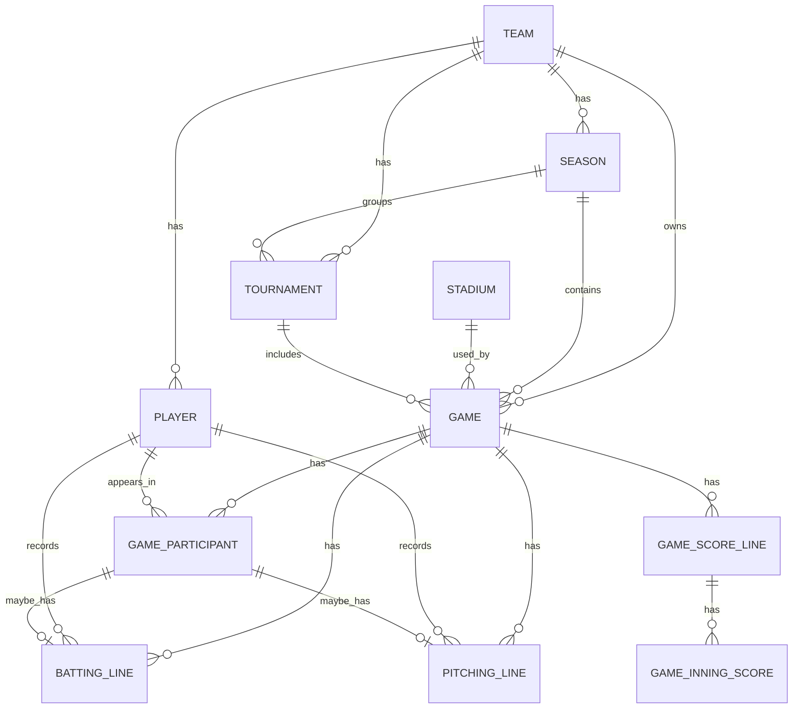

# ドメインモデル整理

対象: 新琴似CATS 非公式公開サイト MVP のドメインモデル整理
この文書はドメイン上の意味・関係・ルールを正とする。物理スキーマは
[DB設計](database-design.md)、公開契約は [API設計](api-design.md) を参照する。

## 1. ドメイン全体像

- マスタ系: `Team`, `Season`, `Player`, `Tournament`, `Stadium`
- 試合系: `Game`, `GameParticipant`
- 成績系: `BattingLine`, `PitchingLine`
- 集計・表示系: `Ranking`, `TeamSummary`

## 2. MVPで扱うモデル

| モデル            | 役割               | 主な関係                                        |
| ----------------- | ------------------ | ----------------------------------------------- |
| `Team`            | チームの起点       | `Season`, `Player`, `Game` とつながる           |
| `Season`          | 年度単位           | `Team` に属し、`Game` を持つ                    |
| `Player`          | 選手の基本情報     | `Team` に属し、`GameParticipant` から参照される |
| `Game`            | 試合の基本情報     | `Season`, `Tournament`, `Stadium` と関係する    |
| `GameParticipant` | 試合時点の出場情報 | `Game` に属し、必要に応じて `Player` を参照する |
| `BattingLine`     | 打撃成績           | `GameParticipant` に紐づく                      |
| `PitchingLine`    | 投手成績           | `GameParticipant` に紐づく                      |
| `GameScoreLine`   | チーム別スコア集計 | `Game` に属し、イニングスコアを持つ             |
| `GameInningScore` | 1イニングの得点    | `GameScoreLine` に属する                        |
| `Tournament`      | 大会・リーグ       | `Team`, `Season`, `Game` と関係する             |
| `Stadium`         | 球場               | `Game` から参照される                           |

## 3. C. 将来構想として扱うモデル

- 認証・権限: `User`, `TeamMembership`, `Role`
  - 公開サイト MVP では不要。
- 問い合わせ: `ContactInquiry`
  - 問い合わせフォームを作らないため不要。
- 表彰・コンテンツ: `Award`, `Photo`, `PhotoAlbum`
  - MVP では成績公開を優先する。
- 詳細記録: `GameEvent`, `BattingPlateAppearance`, `FieldingLine`
  - 入力負荷が高いため将来対応とする。
- 集計保存・スナップショット: `PlayerSummary`, `TeamSummarySnapshot`, `RankingSnapshot`
  - DBにはまだ持たず、必要になった段階で追加する。

## 4. モデル間の関係

主要な関係は以下の通り。

## 5. 重要な設計判断

- 助っ人は `Player` ではなく `GameParticipant` で扱う
- 試合時点の名前・背番号・ポジションはスナップショットとして保持する
- 相手チームの詳細成績は MVP では扱わない
- 打撃成績と投手成績は分ける
- 認証・権限系モデルは MVP では持たない

## 6. MVPでの公開データ範囲

- 公開MVPでは、試合基本情報・出場選手・試合単位の打撃/投手成績・イニングスコアを
  DBに保持し、読み取りAPIとWebで提供する
- 現在のAPIは公開読み取り専用であり、試合・選手・成績を登録・更新する入力APIは実装していない
- 打席単位、守備詳細は将来拡張とする。イニングスコアは `GameInningScore` で扱う
- 入力APIの候補は [入力API設計](input-api-design.md) に分離して記載する

## 7. 将来拡張

- 管理機能: 試合登録や選手登録を追加する。
- 認証・権限: ログイン、招待、ロール管理を追加する。
- 複数チーム対応: チーム切替やチーム追加を可能にする。
- 詳細な試合記録: 打席別、守備詳細を追加する。
- 表彰・写真: MVP、写真、アルバムを追加する。
- 集計スナップショット: 月次・シーズン確定の集計を保存する。

## 8. 用語集

- `Team`: チームそのもの
- `Player`: チーム所属の選手
- `Guest Player`: 試合単位の助っ人選手
- `Game`: 1 試合
- `GameParticipant`: 試合に参加した人のスナップショット
- `BattingLine`: 1 試合の打撃成績
- `PitchingLine`: 1 試合の投手成績
- `Season`: 年度や活動期間の区切り
- `Tournament`: 大会やリーグのまとまり
- `Stadium`: 試合会場
- `PlayerSummary`: 選手単位の集約情報。DB保存は将来検討。
- `TeamSummary`: トップページなどで表示するチーム全体の集約情報。
- `Ranking`: 順位付きの表示

## 9. 参照ドキュメント

- [画面・サイト方針](new-site-plan.md)
- [DB設計](database-design.md)
- [API設計](api-design.md)
- [入力API設計](input-api-design.md)
- [実装ロードマップ](implementation-roadmap.md)
